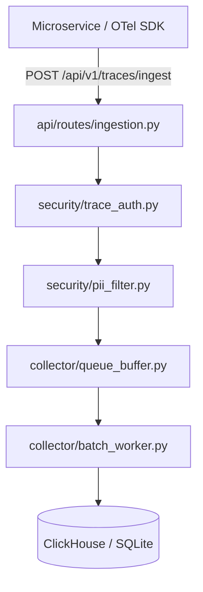
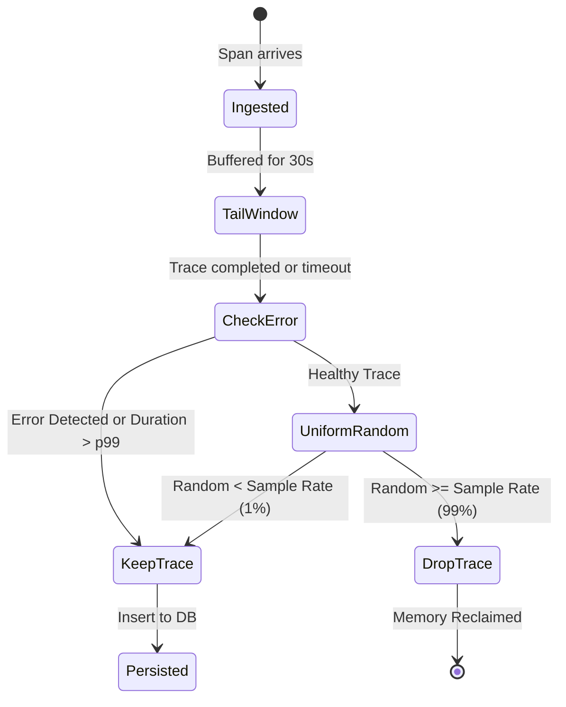
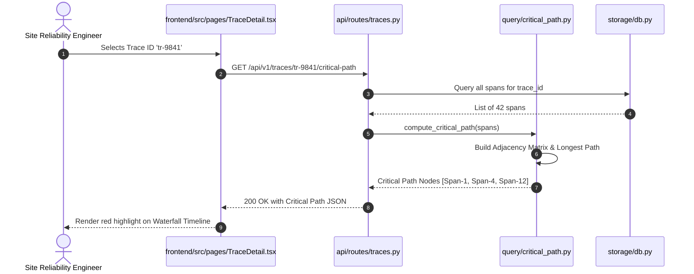
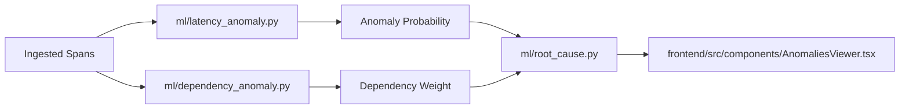
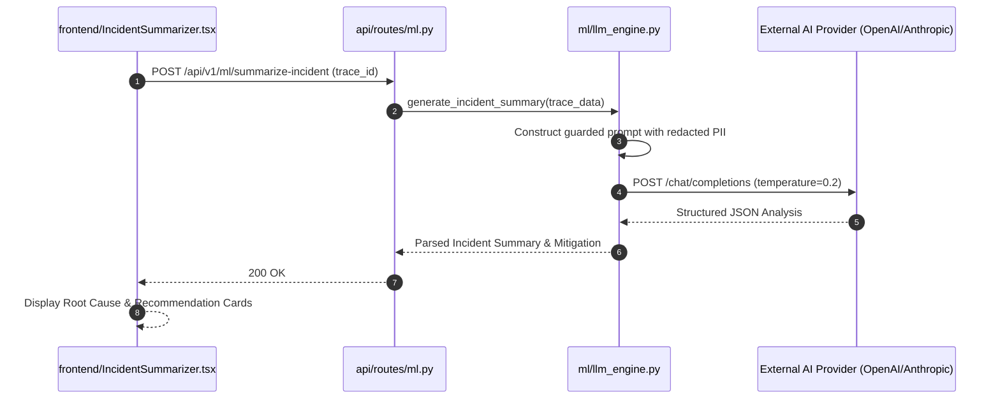

# Full Project Analysis: Distributed Tracing Observability Suite

## 0.1 What the Project Is

**14-Tracing-Backend** is an enterprise-grade distributed tracing and observability system designed to capture, process, index, and analyze request flows traversing complex microservice topologies. It implements OpenTelemetry (OTel) standard ingestion, tail-based intelligent sampling, dynamic trace DAG reconstruction, ML-driven anomaly detection, and pre-trained LLM incident postmortem generation.

### Target Problem
In distributed architectures, single user actions fan out into dozens of asynchronous RPCs and database queries. When latency spikes or partial failures occur, traditional log aggregators fail because log lines lack causal linkage across service boundaries. This project provides end-to-end trace correlation, critical path identification, and automated root cause diagnosis.

### Main User Journeys
1. **Developer Ingests Telemetry**: Services send OTLP JSON/Protobuf span batches to `/api/v1/traces/ingest`. Spans are validated, scrubbed of PII, and buffered.
2. **SRE Inspects Latency Spikes**: The engineer opens the React Trace Explorer, filters for spans with status code `500` or duration `> 500ms`, and opens the Trace Detail page.
3. **Automated Root Cause Triage**: The system highlights the critical execution path in red, displays an ML anomaly score, and presents an LLM-generated narrative explaining which downstream database lock triggered the bottleneck.

---

## 0.2 Feature Inventory & End-to-End Traces

### F1: OpenTelemetry OTLP Collector & Backpressure Queue
- **Frontend / Ingest Point**: HTTP client or agent POSTs to `/api/v1/traces/ingest`
- **Backend Flow**: `api/routes/ingestion.py` -> `collector/validator.py` -> `security/pii_filter.py` -> `collector/queue_buffer.py` -> `storage/db.py`
- **Database Operations**: Batched async inserts into `spans` table with indexed `trace_id`, `service_name`, and `start_time_us`.

### F2: Tail-Based Adaptive Sampling Engine
- **Logic**: Retains 100% of traces containing HTTP 5xx or latency $> p99$, while uniformly sampling healthy 200 OK traces at 1%.
- **Files**: `backend/src/sampling/tail.py`, `sampling/tail_window.py`, `sampling/error_aware.py`

### F3: Span Directed Acyclic Graph (DAG) & Critical Path Engine
- **Logic**: Traverses parent-child span relationships, establishes topological order, detects clock skew, and computes the longest delay path.
- **Files**: `backend/src/query/critical_path.py`, `query/trace_lookup.py`

### F4: Machine Learning Anomaly Detection & Causal Graph
- **Logic**: Evaluates latency distributions across rolling windows using z-score heuristics and dependency graphs.
- **Files**: `ml/latency_anomaly.py`, `ml/dependency_anomaly.py`, `ml/root_cause.py`

### F5: Pre-trained LLM Automated Incident Summarizer
- **Logic**: Aggregates offending spans, error logs, and topology into a prompt payload sent to OpenAI/Claude API, rendering root cause explanations.
- **Files**: `ml/llm_engine.py`, `api/routes/ml.py`, `frontend/src/components/IncidentSummarizer.tsx`

---

## 0.8 Final Inventory Baseline Counts

| Category | Audited Count | Verification Source |
| :--- | :---: | :--- |
| **Backend Route Modules** | 11 | `backend/src/api/routes/*.py` |
| **Total REST Endpoints** | 38 | FastAPI router definitions |
| **Collector Components** | 16 | `backend/src/collector/*.py` |
| **Sampling Modules** | 14 | `backend/src/sampling/*.py` |
| **Security & Auth Modules**| 13 | `backend/src/security/*.py` |
| **ML Engine Modules** | 11 | `ml/*.py` |
| **Frontend Components** | 12 | `frontend/src/components/*.tsx` |
| **Frontend Pages** | 3 | `frontend/src/pages/*.tsx` |
| **Automated Unit Tests** | 313 | `backend/tests/` passing test suite |
