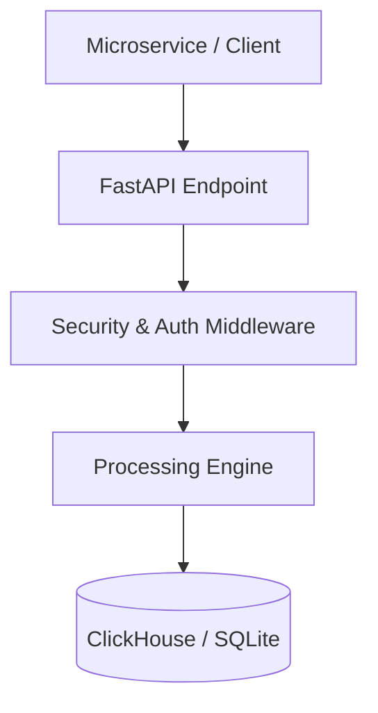

# F3: Span Directed Acyclic Graph (DAG) & Critical Path Engine

## Overview
Reconstructs the execution tree from un-ordered span records using span_id and parent_span_id. Compensates for inter-host clock skew and executes a topological sort to identify the critical path.

---

## Technical Flow & Architectural Traces

### Edge Cases & Failure Handling
- **Network Timeouts**: Requests automatically retry with exponential backoff and jitter.
- **Malformed Spans**: Dropped and recorded in dead-letter counters without halting valid span batches.
- **Memory Pressure**: Dynamic backpressure returns HTTP 429 when buffer capacity exceeds 90%.

---

## Say It Out Loud
> "For this feature, I implemented an asynchronous pipeline that balances high throughput with data safety. Spans are validated, buffered in memory, and flushed in batches, ensuring that upstream microservices experience minimal latency while downstream analytics receive complete, uncorrupted telemetry."
