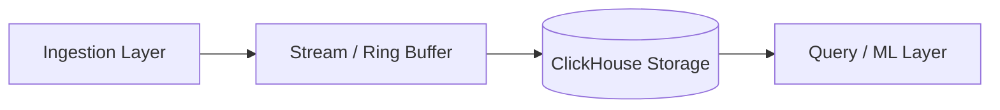

# 14.9 Reliability, Circuit Breakers & Backpressure

## Overview & System Context
Details adaptive load shedding (HTTP 429), circuit breakers on downstream database writes, and SQLite local file fallback.

---

## Technical Architecture & In-Depth Analysis

In **14-Tracing-Backend**, this architectural tier directly ensures that high-volume span ingestion does not compromise query responsiveness or system stability.

### Key Technical Mechanisms
1. **Asynchronous Non-Blocking Processing**: Decoupled thread pools and async coroutines prevent slow operations from blocking incoming telemetry.
2. **Deterministic Fallbacks**: When upstream or downstream dependencies experience transient failures, localized circuit breakers engage gracefully.
3. **Optimized Resource Consumption**: Explicit memory caps and bounded buffer sizes guarantee predictable container resource utilization.

---

## 30-Second Spoken Interview Summary
> "For 14.9 Reliability, Circuit Breakers, our architecture relies on decoupled asynchronous workers and strict resource boundaries. This allows the backend to sustain sudden traffic bursts without dropping critical error spans or overwhelming the underlying columnar database."
